# Weather Prediction Analytics — Snowflake · Airflow · dbt · Superset

An end-to-end analytics pipeline that pulls daily weather history **and** 7-day forecasts for two
cities (San Jose, CA and Seattle, WA) from the [Open-Meteo API](https://open-meteo.com/). It loads
the data into **Snowflake** with an idempotent **Airflow** ETL, then uses **dbt** to turn it into
analytical metrics (moving averages, temperature anomaly, rolling rainfall, dry-spell length). The
results are shown in an **Apache Superset** dashboard.

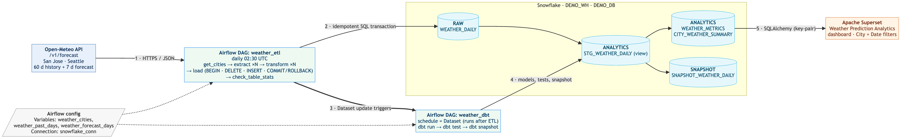

---

## Table of contents
1. [Problem statement](#1-problem-statement)
2. [Requirements](#2-requirements)
3. [Specifications](#3-specifications)
4. [System design & data flow](#4-system-design--data-flow)
5. [Table structures](#5-table-structures)
6. [Airflow](#6-airflow)
7. [dbt](#7-dbt)
8. [BI dashboard (Superset)](#8-bi-dashboard-superset)
9. [How to run](#9-how-to-run)
10. [Repository structure](#10-repository-structure)
11. [Future work](#11-future-work)
12. [Conclusion](#12-conclusion)
13. [References](#13-references)

---

## 1. Problem statement

Raw daily weather numbers (a max temperature, a precipitation total) answer "what happened
today?" but not the questions people actually plan around:

* Is this week **warmer or colder than normal** for this city?
* What is the **trend** once the day-to-day noise is smoothed out?
* How much rain has fallen **recently**? Has a **dry spell** started, and how long has it lasted?
* How do two climates compare: dry, Mediterranean **San Jose** against wet, marine **Seattle**?
* What does the **forecast** say about the next 7 days relative to that baseline?

This project automates collecting the data, stores it reliably in a cloud data warehouse,
computes these metrics with tested SQL transformations, and presents them in an interactive
dashboard that refreshes every day without manual work.

## 2. Requirements

| # | Requirement | How it is met |
|---|---|---|
| R1 | Collect weather for **two or more cities** from Open-Meteo | `weather_etl` fetches every city listed in the `weather_cities` Airflow Variable (San Jose, Seattle) |
| R2 | Store raw data in **Snowflake** | `DEMO_DB.RAW.WEATHER_DAILY`, primary key `(city, date)` |
| R3 | ETL orchestrated by **Airflow**, credentials and settings kept out of code | Airflow **Connection** `snowflake_conn` + **Variables** `weather_cities`, `weather_past_days`, `weather_forecast_days` |
| R4 | **Idempotent** load using a SQL transaction with try / except / raise | `BEGIN` → `DELETE` window → `INSERT` → `COMMIT`; `ROLLBACK` + `raise` on any error |
| R5 | Transform with **dbt**: models, tests, snapshot | 3 models, 23 data tests (21 generic + 2 singular), 1 SCD-2 snapshot |
| R6 | dbt runs as an **Airflow DAG scheduled after the ETL** | `weather_dbt` uses `schedule=[Dataset]`, so it is triggered by the ETL's load task |
| R7 | Visualize the metrics in a **BI tool** | Superset dashboard with 6 charts and City + Date Range filters |

## 3. Specifications

**Stack**

| Layer | Technology | Version |
|---|---|---|
| Source | Open-Meteo Forecast API (`/v1/forecast`), no API key | v1 |
| Orchestration | Apache Airflow (Docker, LocalExecutor) | 2.10.1 |
| Warehouse | Snowflake (warehouse `DEMO_WH`, database `DEMO_DB`) | — |
| Transformation | dbt-core + dbt-snowflake | 1.8.7 / 1.8.1 |
| BI | Apache Superset (Docker) | 4.1.1 |
| Auth to Snowflake | RSA key-pair (private key mounted read-only, never committed) | — |

**Data collected per city per day:** `temperature_2m_max/min/mean`, `precipitation_sum`,
`rain_sum`, `wind_speed_10m_max`, `weather_code`, for **60 days of history + 7 days of forecast**
on each run. Days with no data are skipped.

**Metrics (all in `ANALYTICS.WEATHER_METRICS`, partitioned by city, ordered by date):**

| Metric | Definition |
|---|---|
| `temp_ma_7d_c`, `temp_ma_30d_c` | Moving average of daily mean temperature over the last 7 / 30 rows |
| `baseline_temp_c` | Mean of `temp_mean_c` over **observed** (non-forecast) days for that city |
| `temp_anomaly_c` | `temp_mean_c − baseline_temp_c` |
| `temp_anomaly_zscore` | Anomaly ÷ standard deviation of the city's observed daily mean |
| `rain_rolling_7d_mm`, `rain_rolling_30d_mm` | Precipitation summed over the last 7 / 30 days |
| `is_dry_day` | `precipitation_mm < 1.0` (WMO convention; the dbt var `dry_day_threshold_mm`) |
| `dry_spell_length_days` | Consecutive dry days ending on this date (0 on a wet day), computed with a gaps-and-islands window |

## 4. System design & data flow


<details><summary>Mermaid source (renders on GitHub)</summary>

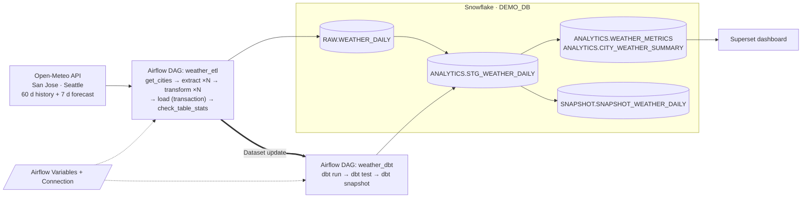
</details>

1. **Extract.** `weather_etl` reads the city list from an Airflow Variable and, through
   *dynamic task mapping*, runs one `extract` task per city against Open-Meteo.
2. **Transform.** One `transform` task per city flattens the API's column arrays into rows,
   flags forecast days (`date >= today` in the city's timezone) and drops days with no data.
3. **Load.** `load` writes all cities into `RAW.WEATHER_DAILY` inside **one SQL transaction**,
   then marks the `snowflake://DEMO_DB/RAW/WEATHER_DAILY` **Dataset** as updated.
4. **dbt.** That Dataset update triggers `weather_dbt`, which runs `dbt run`, then `dbt test`,
   then `dbt snapshot`, building the staging view, the metric marts and the snapshot.
5. **BI.** Superset queries the `ANALYTICS` marts directly in Snowflake.

## 5. Table structures

All objects live in `DEMO_DB`. Column types and nullability below come from Snowflake's
`INFORMATION_SCHEMA.COLUMNS`.

### 5.1 `RAW.WEATHER_DAILY` (table, created and loaded by Airflow)

| Field | Type | Null | Constraint / default | Description |
|---|---|---|---|---|
| `CITY` | VARCHAR(50) | NO | **PK (part 1)** | City name from `weather_cities` |
| `LATITUDE` | NUMBER(9,6) | NO | | Requested latitude |
| `LONGITUDE` | NUMBER(9,6) | NO | | Requested longitude |
| `DATE` | DATE | NO | **PK (part 2)** | Local calendar day |
| `TEMP_MAX` | FLOAT | YES | | Daily max temperature 2 m (°C) |
| `TEMP_MIN` | FLOAT | YES | | Daily min temperature 2 m (°C) |
| `TEMP_MEAN` | FLOAT | YES | | Daily mean temperature 2 m (°C) |
| `PRECIPITATION_SUM` | FLOAT | YES | | Total precipitation (mm) |
| `RAIN_SUM` | FLOAT | YES | | Rain only (mm) |
| `WIND_SPEED_MAX` | FLOAT | YES | | Max wind speed 10 m (km/h) |
| `WEATHER_CODE` | NUMBER(38,0) | YES | | WMO weather code |
| `IS_FORECAST` | BOOLEAN | NO | | `TRUE` for today and later |
| `LOADED_AT` | TIMESTAMP_NTZ | NO | `DEFAULT CURRENT_TIMESTAMP()` | Load time (dbt source freshness field) |

Primary key: `(CITY, DATE)`. Snowflake does not enforce primary keys, so uniqueness is
guaranteed by the delete-then-insert transaction and checked by the dbt `unique` test on
`weather_id`.

### 5.2 `ANALYTICS.STG_WEATHER_DAILY` (dbt view)

| Field | Type | Null | Tests | Description |
|---|---|---|---|---|
| `WEATHER_ID` | VARCHAR | YES | `unique`, `not_null` | Surrogate key `city|date` |
| `CITY` | VARCHAR(50) | NO | `not_null` | |
| `LATITUDE`, `LONGITUDE` | NUMBER(9,6) | NO | | |
| `DATE` | DATE | NO | `not_null` | |
| `TEMP_MAX_C`, `TEMP_MIN_C` | FLOAT | YES | singular: max ≥ min | °C |
| `TEMP_MEAN_C` | FLOAT | YES | `not_null` | Falls back to (max+min)/2 |
| `TEMP_RANGE_C` | FLOAT | YES | | max − min |
| `PRECIPITATION_MM`, `RAIN_MM` | FLOAT | YES | `not_null` (precip.) | NULL → 0 |
| `WIND_SPEED_MAX_KMH` | FLOAT | YES | | |
| `WEATHER_CODE` | NUMBER(38,0) | YES | | |
| `WEATHER_CATEGORY` | VARCHAR(12) | YES | `accepted_values` | Clear, Cloudy, Fog, Drizzle, Rain, Rain Showers, Snow, Snow Showers, Thunderstorm, Unknown |
| `IS_FORECAST` | BOOLEAN | NO | `not_null` | |
| `LOADED_AT` | TIMESTAMP_NTZ | NO | | |

### 5.3 `ANALYTICS.WEATHER_METRICS` (dbt table)

| Field | Type | Tests | Description |
|---|---|---|---|
| `WEATHER_ID` | VARCHAR | `unique`, `not_null`, `relationships` → stg | Key |
| `CITY`, `DATE`, `IS_FORECAST`, `WEATHER_CATEGORY` | VARCHAR / DATE / BOOLEAN / VARCHAR | | From staging |
| `TEMP_MAX_C`, `TEMP_MIN_C`, `TEMP_MEAN_C`, `TEMP_RANGE_C` | FLOAT | | °C |
| `PRECIPITATION_MM`, `WIND_SPEED_MAX_KMH` | FLOAT | | |
| `TEMP_MA_7D_C`, `TEMP_MA_30D_C` | FLOAT | `not_null` | Moving averages |
| `BASELINE_TEMP_C` | FLOAT | | Observed-day mean per city |
| `TEMP_ANOMALY_C` | FLOAT | `not_null` | Deviation from baseline |
| `TEMP_ANOMALY_ZSCORE` | FLOAT | | Standardized anomaly |
| `RAIN_ROLLING_7D_MM`, `RAIN_ROLLING_30D_MM` | FLOAT | `not_null` | Rolling rainfall |
| `IS_DRY_DAY` | BOOLEAN | singular: spell consistency | precip < 1 mm |
| `DRY_SPELL_LENGTH_DAYS` | NUMBER(13,0) | `not_null`, singular | Consecutive dry days |

### 5.4 `ANALYTICS.CITY_WEATHER_SUMMARY` (dbt table, one row per city, observed days only)

| Field | Type | Tests | Description |
|---|---|---|---|
| `CITY` | VARCHAR(50) | `unique`, `not_null` | |
| `FIRST_DATE`, `LAST_DATE` | DATE | | Observed range |
| `OBSERVED_DAYS` | NUMBER(18,0) | | |
| `AVG_TEMP_C`, `RECORD_HIGH_C`, `RECORD_LOW_C` | FLOAT | | |
| `TOTAL_PRECIPITATION_MM` | FLOAT | | |
| `DRY_DAYS`, `LONGEST_DRY_SPELL_DAYS` | NUMBER(13,0) | | |
| `MAX_ABS_TEMP_ANOMALY_C` | FLOAT | | Largest deviation from baseline |

### 5.5 `SNAPSHOT.SNAPSHOT_WEATHER_DAILY` (dbt snapshot, SCD Type 2)

All `STG_WEATHER_DAILY` columns plus dbt's metadata columns:

| Field | Type | Description |
|---|---|---|
| `DBT_SCD_ID` | VARCHAR(32) | Unique id of each row version |
| `DBT_UPDATED_AT` | TIMESTAMP_NTZ | When dbt captured this version |
| `DBT_VALID_FROM` | TIMESTAMP_NTZ | Version start |
| `DBT_VALID_TO` | TIMESTAMP_NTZ | Version end (`NULL` = current) |

Strategy `check` on `temp_max_c, temp_min_c, temp_mean_c, precipitation_mm, weather_code,
is_forecast`, with unique key `weather_id`. Open-Meteo revises recent days and forecasts on
every run, so each daily run records a new version whenever a forecast changes or a forecast
day becomes an observed day.

## 6. Airflow

### 6.1 DAGs

| DAG | File | Schedule | Tasks |
|---|---|---|---|
| `weather_etl` | [`dags/weather_etl.py`](dags/weather_etl.py) | `30 2 * * *` (daily) | `get_cities → extract[mapped] → transform[mapped] → load → check_table_stats` |
| `weather_dbt` | [`dags/weather_dbt.py`](dags/weather_dbt.py) | `[Dataset("snowflake://DEMO_DB/RAW/WEATHER_DAILY")]` | `dbt_run → dbt_test → dbt_snapshot` |

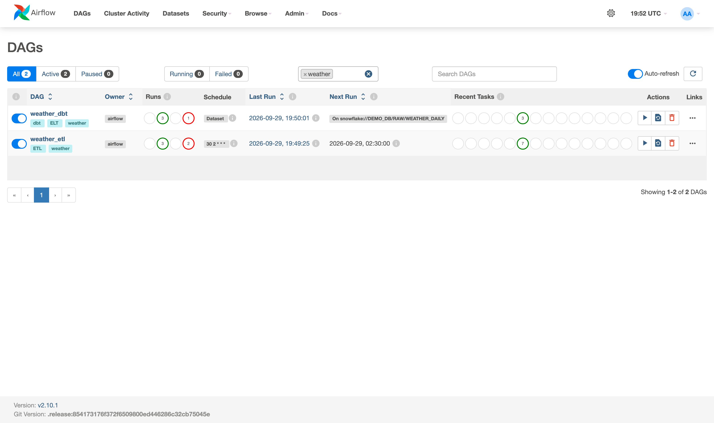

**ETL pipeline graph.** The mapped `extract [2]` / `transform [2]` tasks run once per city, and
`load` publishes the Dataset:

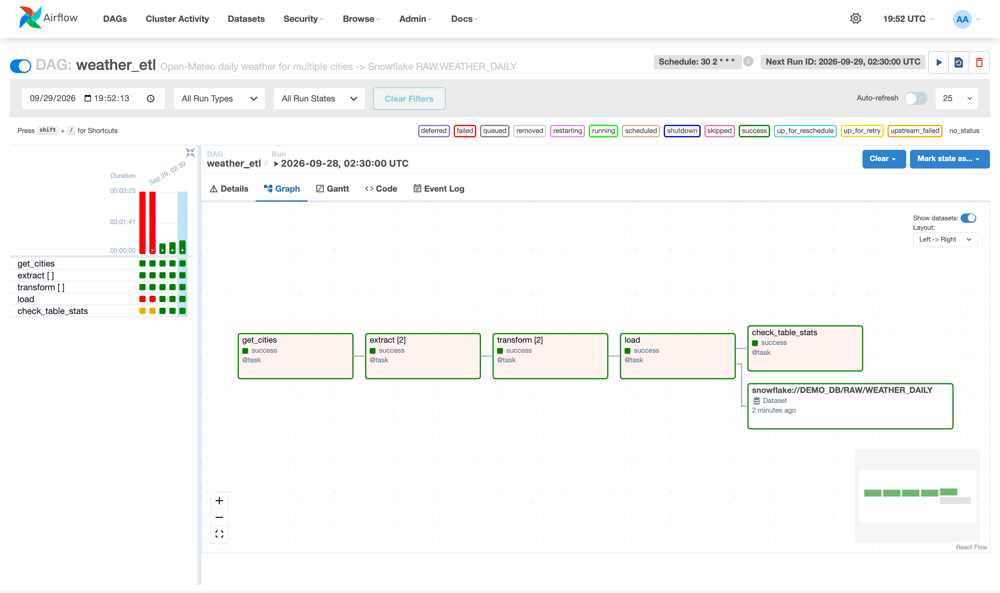

**dbt DAG, scheduled by the Dataset, so it always runs after the ETL:**

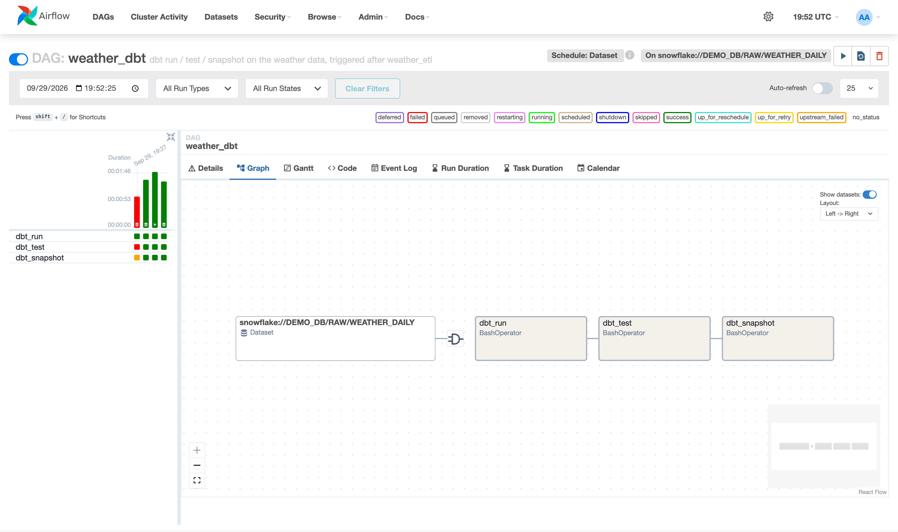

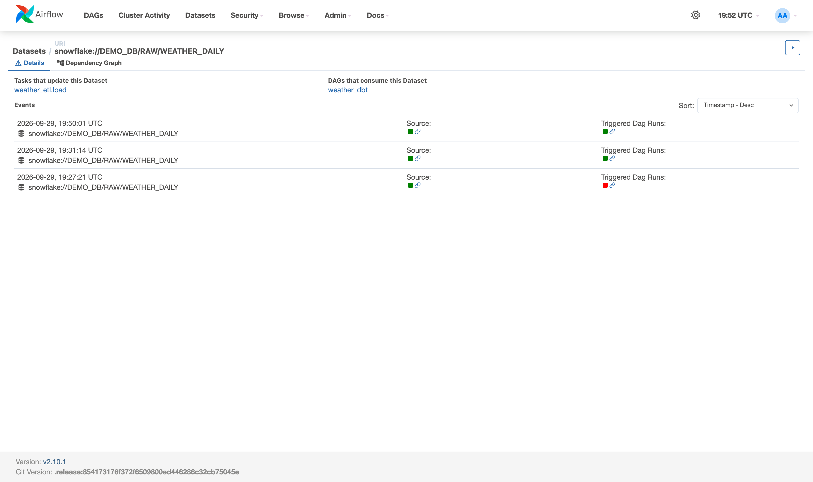

Run history (the early red runs happened while the original Snowflake trial account was
suspended; they succeeded once the connection was pointed at the new account):

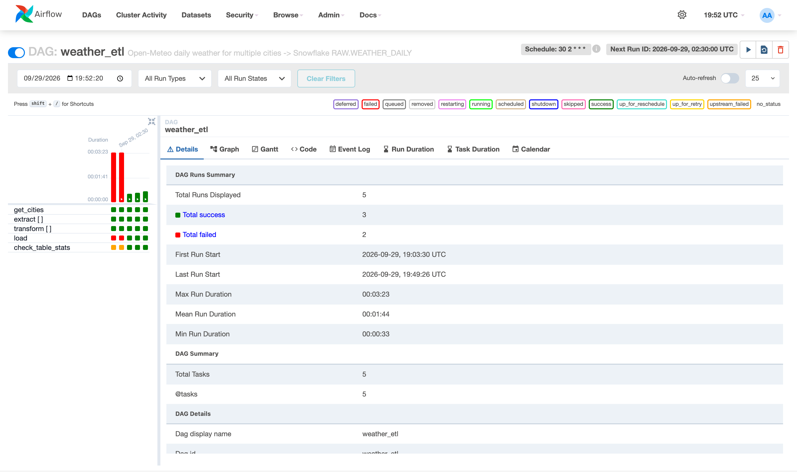

### 6.2 Connections and Variables

No credentials or tunable settings are hard-coded in the DAGs.

| Kind | Key | Value / purpose |
|---|---|---|
| Connection | `snowflake_conn` | Type `snowflake`; login = Snowflake user; extras: `account`, `warehouse=DEMO_WH`, `database=DEMO_DB`, `role`, `private_key_file=/opt/airflow/keys/rsa_key.p8` |
| Variable | `weather_cities` | JSON list of `{city, latitude, longitude, timezone}`. Add a city here and it is picked up on the next run, with no code change |
| Variable | `weather_past_days` | Days of history per run (60; Open-Meteo keeps about 63 days in the forecast API) |
| Variable | `weather_forecast_days` | Days of forecast per run (7) |

`weather_etl` uses the connection through `SnowflakeHook(snowflake_conn_id="snowflake_conn")`.
`weather_dbt` reads the same connection with `BaseHook.get_connection` and passes its fields to
dbt as environment variables, so [`dbt/profiles.yml`](dbt/profiles.yml) contains only
`env_var()` calls.

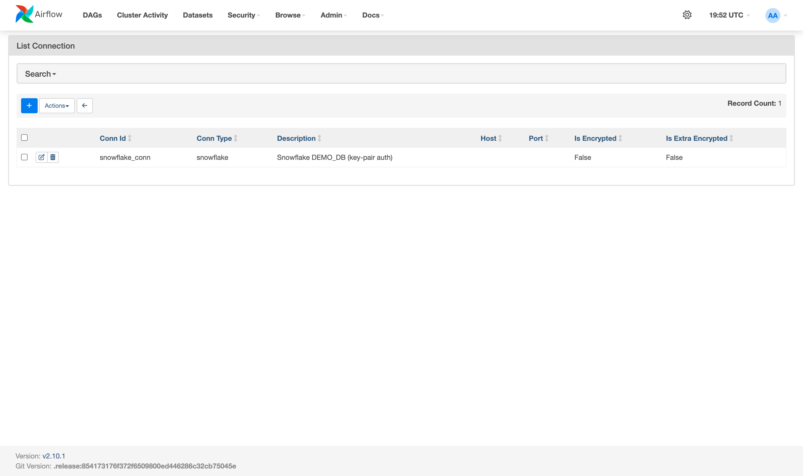
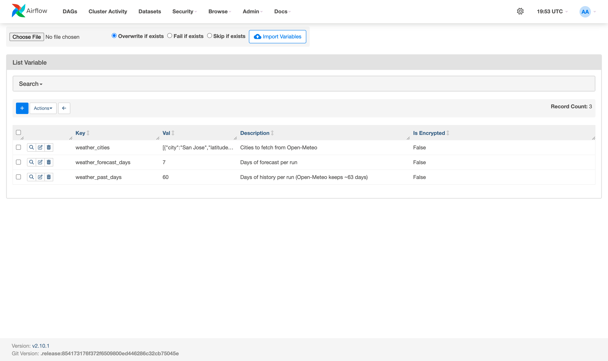

### 6.3 Idempotency: SQL transaction with try / except / raise

From [`dags/weather_etl.py`](dags/weather_etl.py):

```python
try:
    cur.execute("BEGIN;")
    for batch in city_batches:             # one batch per city (mapped task output)
        city, start, end, records = batch["city"], batch["start"], batch["end"], batch["rows"]
        cur.execute(
            f"DELETE FROM {target_table} WHERE city = %s AND date BETWEEN %s AND %s",
            (city, start, end),
        )
        cur.executemany(insert_sql, records)
    cur.execute("COMMIT;")
except Exception as e:
    cur.execute("ROLLBACK;")
    print(f"Load failed, transaction rolled back: {e}")
    raise
```

* **Idempotent.** For each city the load deletes the whole requested date window and then
  inserts it again, so running the DAG twice (or re-running a failed attempt) produces exactly
  the same table. After several runs, `RAW.WEATHER_DAILY` still holds one row per `(city, date)`,
  as the dbt `unique` test confirms.
* **Atomic.** All cities are written in one transaction, so a failure part-way (for example on the
  second city) rolls back everything and the table is never left half-loaded. `raise` makes the
  Airflow task fail, so retries and alerting still happen.
* DDL (`CREATE TABLE IF NOT EXISTS`) runs *before* `BEGIN` because DDL auto-commits in Snowflake.

Load task log (two cities staged, then one commit):

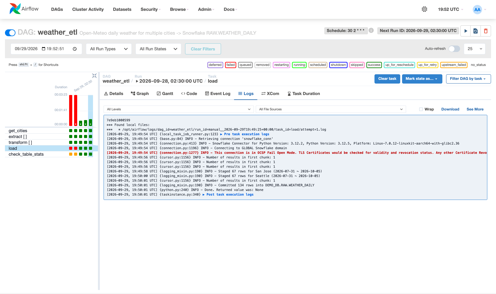

## 7. dbt

Project: [`dbt/`](dbt/) (`profile: weather_analytics`)

```
dbt/
├── dbt_project.yml          # materializations (staging = view, marts = table), var dry_day_threshold_mm
├── profiles.yml             # env_var()-only Snowflake profile (key-pair)
├── models/
│   ├── sources.yml          # source raw.weather_daily + source tests
│   ├── schema.yml           # model docs + generic tests
│   ├── staging/stg_weather_daily.sql
│   └── marts/
│       ├── weather_metrics.sql        # MA, anomaly, rolling rain, dry spell
│       └── city_weather_summary.sql   # per-city KPIs
├── tests/
│   ├── assert_temp_max_not_below_temp_min.sql
│   └── assert_dry_spell_consistent.sql
└── snapshots/snapshot_weather_daily.sql   # SCD-2, check strategy
```

**Tests (23):** `unique`, `not_null`, `accepted_values` and `relationships` generic tests on models
and sources, plus two singular tests (max ≥ min temperature; dry-spell length is consistent with
`is_dry_day`). The tests already proved useful during development: they caught 56 rows with a
NULL mean temperature. The API returns empty days beyond its ~63-day history window, so the ETL
now skips those days.

`dbt run`:
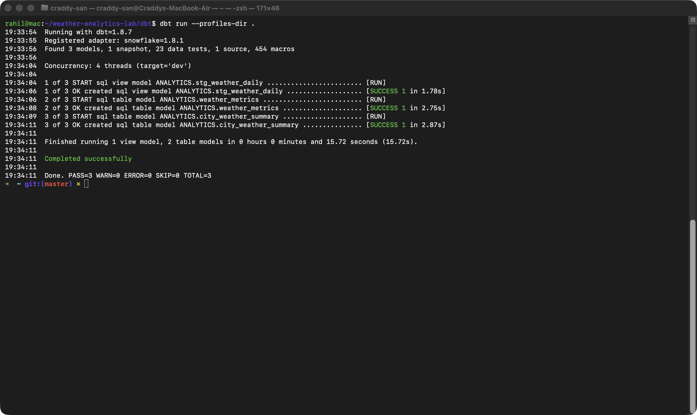

`dbt test` (23 of 23 pass):
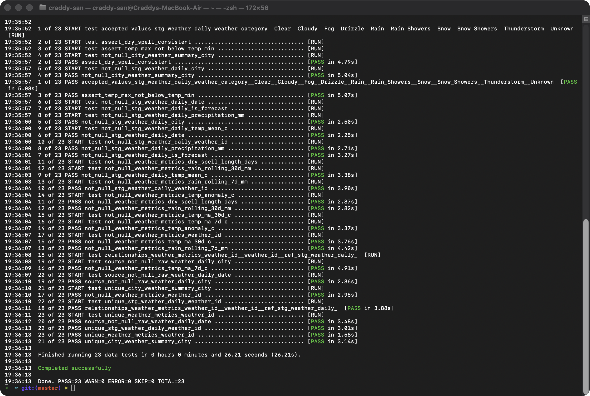

`dbt snapshot`:
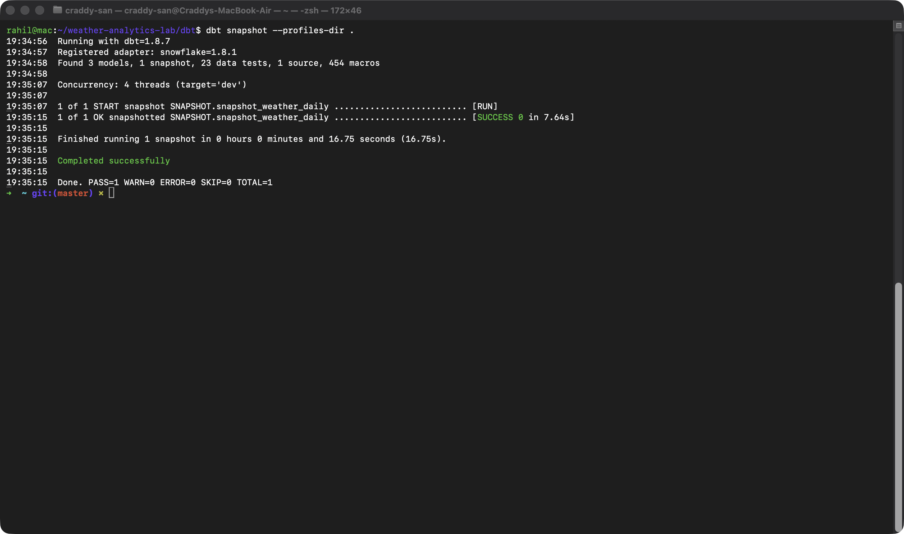

## 8. BI dashboard (Superset)

**Dashboard:** *Weather Prediction Analytics*, at `http://localhost:8088/superset/dashboard/weather-analytics/`

**Purpose.** Compare the recent climate of San Jose and Seattle and put the 7-day forecast in
context: is it warmer or colder than normal, is rain building up, is a dry spell under way?

**Datasets** (Superset → Snowflake `DEMO_DB.ANALYTICS`, key-pair auth):
* `weather_metrics`: daily metrics per city (powers the 4 time-series charts and the forecast table)
* `city_weather_summary`: one row per city (KPI table)

**Charts**

| Chart | Type | What it shows |
|---|---|---|
| Temperature & Moving Averages (°C) | Line | Daily mean vs 7-day and 30-day MA per city |
| Temperature Anomaly vs City Baseline (°C) | Bar | Positive = warmer than the city's normal |
| Rolling Rainfall (mm) | Line | 7-day and 30-day rolling precipitation |
| Dry Spell Length | Line | Consecutive dry days; drops to 0 on a rainy day |
| 7-Day Forecast | Table | Forecast days with category, temps, rain and anomaly |
| City Summary (observed days) | Table | Average, record high/low, total rain, dry days, longest spell |

**Usage.** Use the **City** filter (multi-select) and the **Date Range** filter in the left
panel, then *Apply filters*. All charts are in scope of both filters. The dashboard and charts are
created reproducibly by [`superset/bootstrap_dashboard.py`](superset/bootstrap_dashboard.py)
through the Superset REST API.

**Full dashboard (no filters: Jul 27 → Oct 5, both cities).** In the full view, San Jose shows a
64-day unbroken dry spell and almost zero rainfall, while Seattle's rolling rainfall climbs through
September. Late September is 4–6 °C colder than normal in Seattle, while the San Jose forecast
turns sharply warmer (+5–7 °C) in early October.

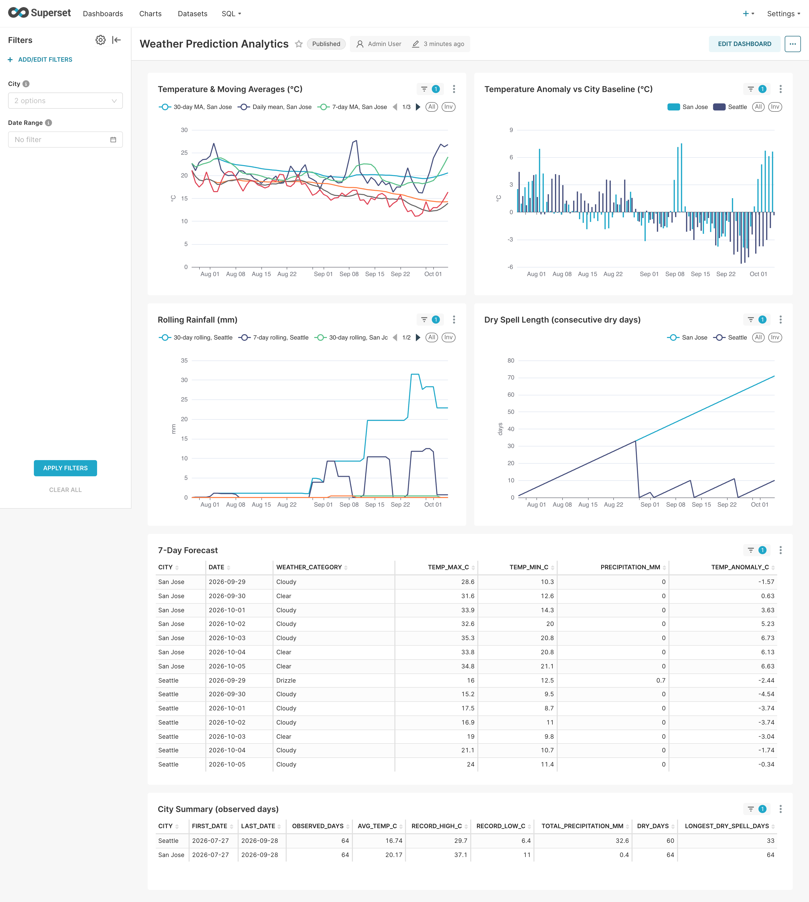

**Date Range changed to 2026-09-01 → 2026-10-06.** Every time-series chart re-queries and the
x-axis narrows to September / early October:

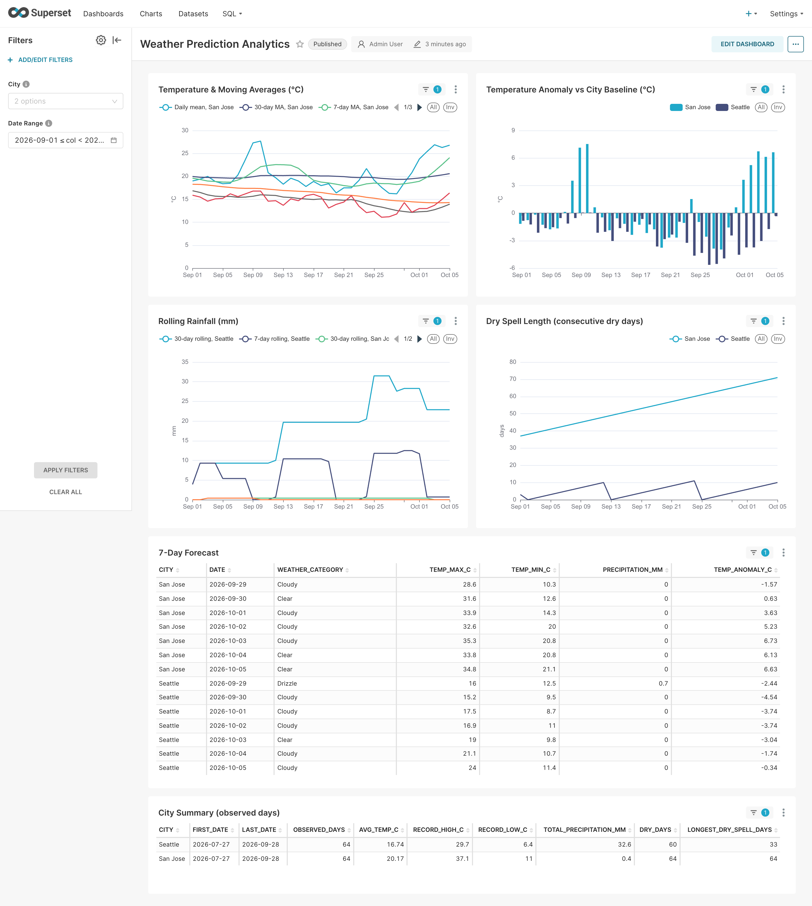

**City filter narrowed to Seattle (plus the same date range).** Only Seattle series and rows remain:

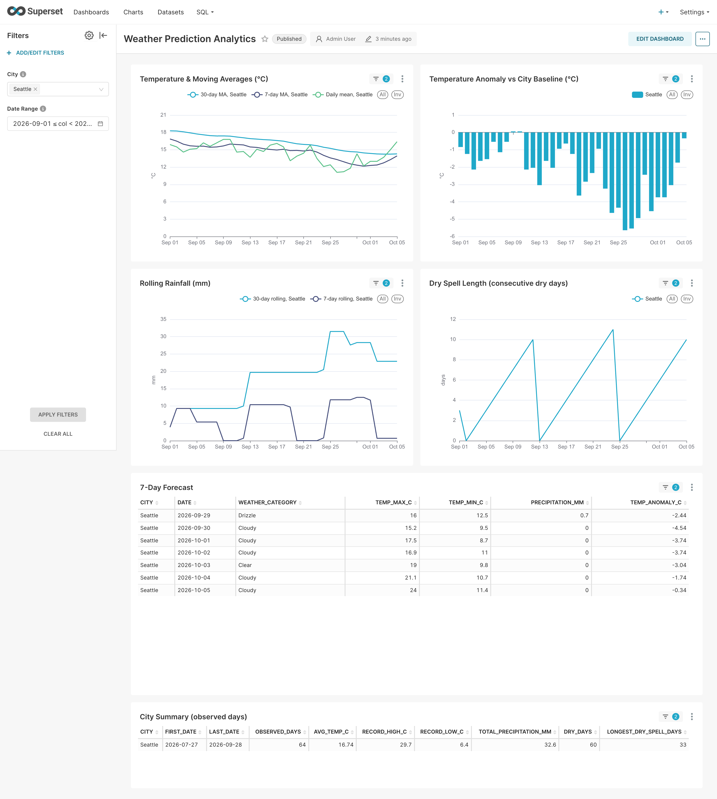

**Each chart individually**

| | |
|---|---|
| 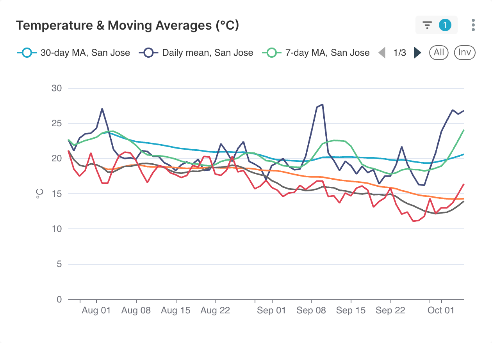 | 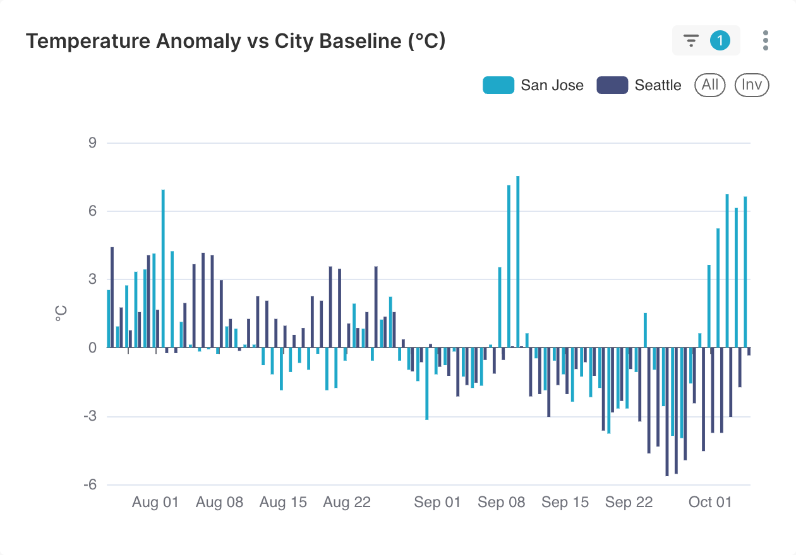 |
| 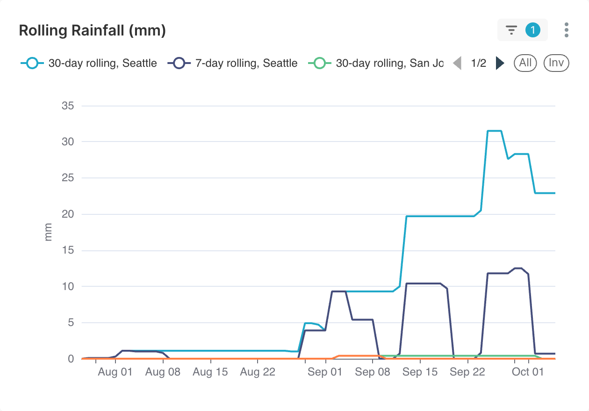 | 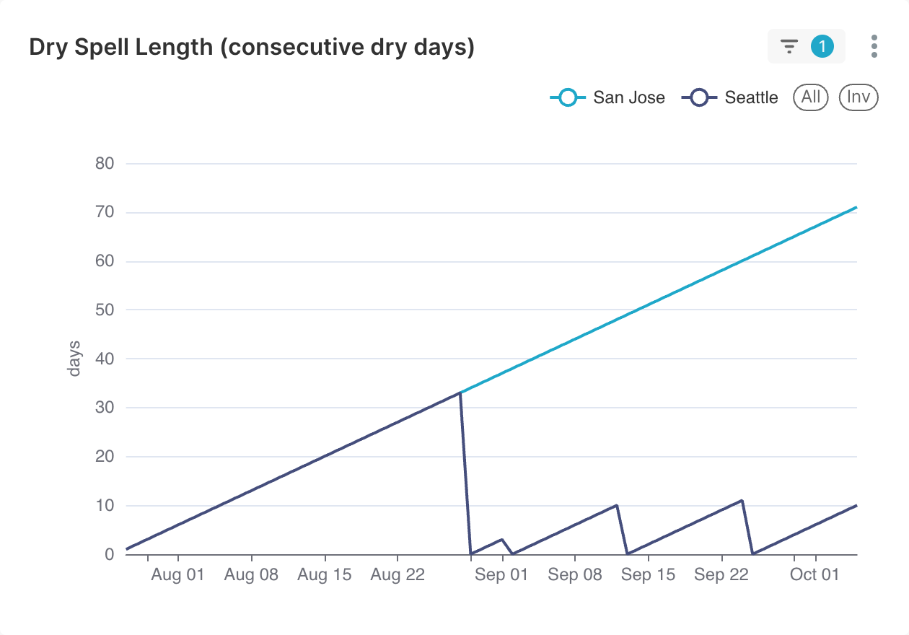 |

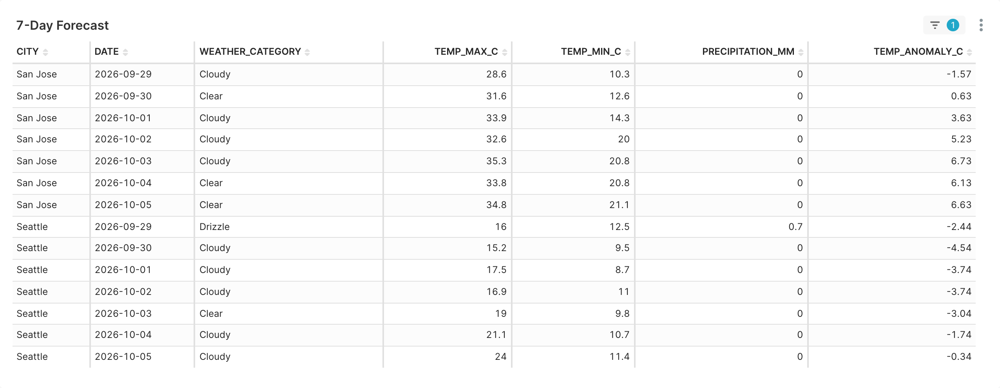
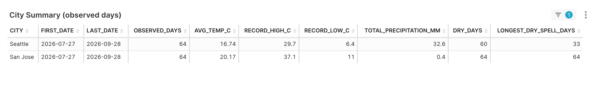

## 9. How to run

**Prerequisites:** Docker Desktop (≥ 4 GB RAM), a Snowflake account with a user that has an RSA
public key registered (`ALTER USER <user> SET RSA_PUBLIC_KEY='...'`), and Python 3.12 (only
needed for running dbt locally or for the Superset bootstrap script).

```bash
# 1. Snowflake objects (run once in a worksheet)
CREATE WAREHOUSE IF NOT EXISTS DEMO_WH WAREHOUSE_SIZE='XSMALL' AUTO_SUSPEND=60;
CREATE DATABASE IF NOT EXISTS DEMO_DB;

# 2. Private key (NOT committed; keys/ is in .gitignore)
mkdir -p keys && cp ~/.ssh/snowflake/rsa_key.p8 keys/

# 3. Start Airflow (http://localhost:8081, airflow/airflow) + Superset (http://localhost:8088, admin/admin)
docker compose up -d

# 4. Airflow connection + variables
docker compose exec airflow airflow connections add snowflake_conn --conn-type snowflake \
  --conn-login <SNOWFLAKE_USER> \
  --conn-extra '{"account":"<ORG-ACCOUNT>","warehouse":"DEMO_WH","database":"DEMO_DB","role":"ACCOUNTADMIN","private_key_file":"/opt/airflow/keys/rsa_key.p8"}'
docker compose exec airflow airflow variables set weather_cities \
  '[{"city":"San Jose","latitude":37.3382,"longitude":-121.8863,"timezone":"America/Los_Angeles"},
    {"city":"Seattle","latitude":47.6062,"longitude":-122.3321,"timezone":"America/Los_Angeles"}]'
docker compose exec airflow airflow variables set weather_past_days 60
docker compose exec airflow airflow variables set weather_forecast_days 7

# 5. Unpause both DAGs, trigger the ETL; weather_dbt starts automatically afterwards
docker compose exec airflow airflow dags unpause weather_dbt
docker compose exec airflow airflow dags unpause weather_etl
docker compose exec airflow airflow dags trigger weather_etl

# 6. Build the Superset dashboard
python -m venv .venv && .venv/bin/pip install requests
.venv/bin/python superset/bootstrap_dashboard.py --account <ORG-ACCOUNT> --user <SNOWFLAKE_USER>
```

Run dbt locally (optional):

```bash
pip install dbt-core==1.8.7 dbt-snowflake==1.8.1
export DBT_ACCOUNT=<ORG-ACCOUNT> DBT_USER=<USER> DBT_PRIVATE_KEY_PATH=~/.ssh/snowflake/rsa_key.p8 \
       DBT_ROLE=ACCOUNTADMIN DBT_WAREHOUSE=DEMO_WH DBT_DATABASE=DEMO_DB
cd dbt && dbt run --profiles-dir . && dbt test --profiles-dir . && dbt snapshot --profiles-dir .
```

## 10. Repository structure

```
weather-analytics-lab/
├── README.md                     # this report
├── docker-compose.yaml           # Airflow 2.10.1 + Postgres + Superset 4.1.1
├── dags/
│   ├── weather_etl.py            # Open-Meteo -> Snowflake ETL (transactional, idempotent)
│   └── weather_dbt.py            # dbt run/test/snapshot, scheduled on the ETL's Dataset
├── dbt/                          # dbt project (models, tests, snapshot)
├── superset/
│   └── bootstrap_dashboard.py    # creates DB connection, datasets, charts, dashboard via REST API
└── docs/
    ├── architecture.png          # system diagram
    └── screenshots/              # Airflow, dbt and Superset screenshots
```

## 11. Future work

* **Forecast accuracy.** The snapshot already keeps every version of each forecast day. Joining
  the version captured N days ahead against the final observed row would score the forecast's
  error (MAE by lead time and by city).
* **Longer baselines.** Backfill years of history from Open-Meteo's *Historical Weather* (ERA5)
  API, so anomalies are measured against a 30-year climate normal instead of the recent window.
* **Incremental models.** Switch `weather_metrics` to an incremental `merge` model once history
  spans years, and add `dbt source freshness` as a DAG task with alerting.
* **More cities and variables.** Cities are configuration, not code. Add humidity, UV index, and
  heat-index / frost-risk alerts.
* **Operations.** Slack/email alerts on failures, `dbt docs` published as an artifact, CI running
  `dbt build` against a dev schema on every pull request.
* **Security.** Keep secrets in a secrets backend (e.g. AWS Secrets Manager) instead of the Airflow
  metadata database, and use a least-privilege Snowflake role instead of `ACCOUNTADMIN`.

## 12. Conclusion

The project delivers an automated, daily ELT pipeline:

* Airflow extracts two cities in parallel with dynamic task mapping.
* The ETL loads Snowflake idempotently inside a single transaction, and all configuration lives
  in Airflow Connections and Variables.
* The ETL signals completion through a Dataset, which triggers the dbt DAG.
* dbt builds tested, documented metric models (23 of 23 tests passing) and keeps an SCD-2
  history of forecast revisions.
* Superset shows the results in an interactive dashboard.

The metrics clearly separate the two climates. San Jose went more than 60 days without meaningful
rain, while Seattle's September rain shows up in its rolling rainfall and reset its dry spells.
The anomaly view shows at a glance that the upcoming San Jose forecast is well above normal. Every
layer can be re-run safely and extended through configuration.

## 13. References

1. Open-Meteo Forecast API documentation: https://open-meteo.com/en/docs
2. WMO weather interpretation codes (used for `weather_category`): https://open-meteo.com/en/docs#weathervariables
3. Apache Airflow 2.10: Data-aware scheduling (Datasets): https://airflow.apache.org/docs/apache-airflow/2.10.1/authoring-and-scheduling/datasets.html
4. Apache Airflow: Dynamic task mapping: https://airflow.apache.org/docs/apache-airflow/2.10.1/authoring-and-scheduling/dynamic-task-mapping.html
5. Airflow Snowflake provider: https://airflow.apache.org/docs/apache-airflow-providers-snowflake/stable/
6. Snowflake: Transactions: https://docs.snowflake.com/en/sql-reference/transactions
7. Snowflake: Key-pair authentication: https://docs.snowflake.com/en/user-guide/key-pair-auth
8. dbt: Snapshots: https://docs.getdbt.com/docs/build/snapshots
9. dbt: Data tests: https://docs.getdbt.com/docs/build/data-tests
10. dbt-snowflake setup: https://docs.getdbt.com/docs/core/connect-data-platform/snowflake-setup
11. Apache Superset REST API: https://superset.apache.org/docs/api
12. Apache Superset: Connecting to Snowflake: https://superset.apache.org/docs/configuration/databases#snowflake
